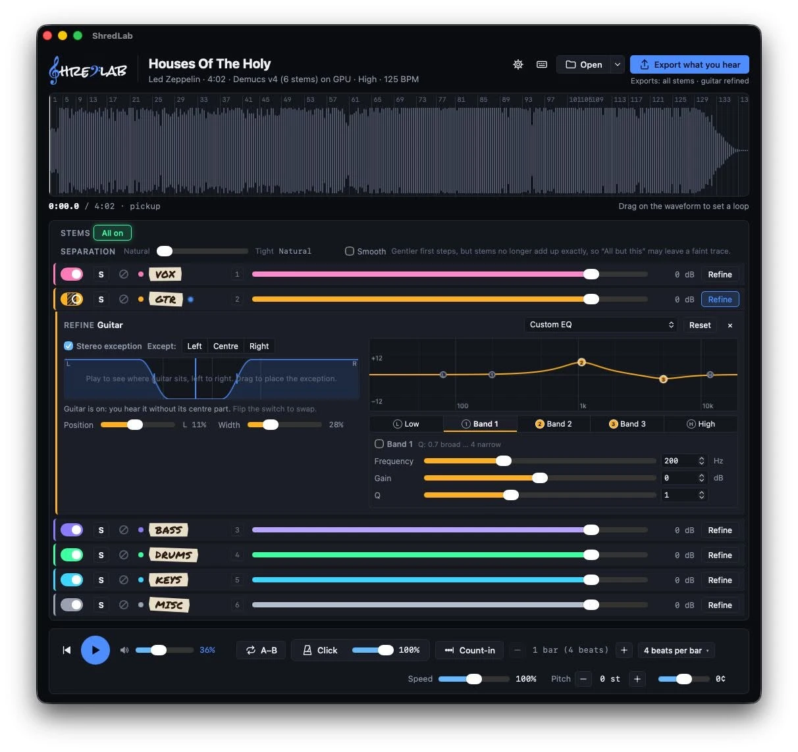

# ShredLab

ShredLab is a desktop practice and transcription tool for musicians.
It separates a song into instruments (vocals, drums, bass, guitar, piano,
other) on your own machine, so you can play along with an instrument
removed or listen to one by itself. You can also slow songs down or speed
them up without changing the pitch, transpose them, loop a section and play
along with a click track and count-in. It is built with
Tauri 2 and a Rust core, runs separation models with ONNX Runtime
(DirectML / CoreML / CPU), and targets Windows and macOS.

## Download

Installers for the latest version are on the
[releases page](https://github.com/njoneja/shredlab/releases/latest):

- **Windows 10/11 (x64):** `ShredLab_<version>_x64-setup.exe` (or the `.msi`)
- **macOS 14+ (Apple Silicon):** `ShredLab_<version>_aarch64.dmg`

The installers are not signed yet, so the first launch shows a warning.
On Windows, choose More info, then Run anyway. On macOS, drag ShredLab to
Applications, open it once, then go to System Settings > Privacy & Security
and choose Open Anyway.

If macOS says the app "is damaged and can't be opened", it is not damaged:
macOS shows this for unsigned apps downloaded from the internet. Move
ShredLab to Applications, then run this once in Terminal and open it again:

```
xattr -dr com.apple.quarantine /Applications/ShredLab.app
```

How to use it: [docs/HELP.md](docs/HELP.md). What's planned:
[ROADMAP.md](ROADMAP.md).



## Repository layout

Status: works end to end on Windows and macOS (separate, beats, mixer,
speed/pitch, loops, click, export). See
[docs/ARCHITECTURE.md](docs/ARCHITECTURE.md) for how it fits together and
[docs/DEVELOPING.md](docs/DEVELOPING.md) for practical development notes.
Each source directory has its own README with the details.

| Path | What |
|---|---|
| `app/` | Tauri app: Svelte 5 + TypeScript + Vite frontend (`app/src`), Rust shell (`app/src-tauri`) |
| `crates/shredlab-dsp` | STFT/iSTFT, chunking, overlap-add |
| `crates/shredlab-io` | Decode, resample, WAV writing |
| `crates/shredlab-separation` | ONNX Runtime sessions, model registry, adapters |
| `crates/shredlab-audio` | Real-time audio engine, offline render, WAV/FLAC/MP3 export |
| `crates/shredlab-beats` | Beat/downbeat detection (Beat This! ONNX) |
| `crates/shredlab-library` | Song folders, JSON manifest, stem cache |
| `crates/shredlab-cli` | `shredlab-cli`, headless CLI |
| `tools/` | Python tooling: model setup/export, model folders, fixtures ([tools/README.md](tools/README.md)) |
| `spikes/` | Python prototypes, including the export code for the bundled models ([spikes/README.md](spikes/README.md)) |
| `scripts/` | Model setup wrappers and separation experiments ([scripts/README.md](scripts/README.md)) |
| `docs/` | User help, architecture, development notes, model manifest format |

## Building from scratch

Tested on Windows 11 x64 and macOS (Apple Silicon); see
[macOS notes](#macos-notes) for the differences on a Mac.

### 1. Prerequisites

- **Rust** stable via [rustup](https://rustup.rs), with `rustfmt` and `clippy`
  (`rustup component add rustfmt clippy`).
- **Node.js 24** ([nodejs.org](https://nodejs.org)) and **pnpm 12**
  ([pnpm.io/installation](https://pnpm.io/installation)).
- A C/C++ compiler (Tauri, the vendored Signalsmith Stretch and LAME are
  compiled from source):
  - Windows: [Visual Studio Build Tools](https://visualstudio.microsoft.com/visual-cpp-build-tools/)
    with the **Desktop development with C++** workload, and WebView2 (preinstalled
    on Windows 11).
  - macOS: Xcode Command Line Tools (`xcode-select --install`).
  - Details: [Tauri prerequisites](https://v2.tauri.app/start/prerequisites/).
- **uv** ([docs.astral.sh/uv](https://docs.astral.sh/uv/getting-started/installation/))
  or **Python 3.12** ([python.org](https://www.python.org/downloads/)), only
  for the one-time model setup.

### 2. Frontend dependencies

```sh
pnpm --dir app install
```

### 3. Models

The ONNX models are not in git (`models/` is ignored). They are built from
the official MIT-licensed checkpoints (Demucs v4 `htdemucs_6s`, Beat This!
`final0`). Every app build needs them, because the Tauri config bundles
them. One command does it all: creates a CPU-only Python venv
(`.venv-models`), downloads the checkpoints (~140 MB, sha256-checked),
exports the ONNX files and verifies them against reference outputs.

```powershell
# Windows (PowerShell)
.\scripts\setup-models.ps1
```

```sh
# macOS
./scripts/setup-models.sh
```

Or run `python tools/setup_models.py` with any Python 3.9+ directly. It takes
a few minutes (mostly downloading ~250 MB of PyTorch and ~140 MB of
checkpoints; the exports themselves take seconds to a minute) and about
1.7 GB of disk: ~1.4 GB for `.venv-models` (delete it afterwards if you
like) and ~320 MB in `models/`. Running it again skips everything that is
already there; `--force` rebuilds (old files are kept as `*.bak-*`),
`--out DIR` writes somewhere else. See [tools/README.md](tools/README.md).

### 4. Build and run

From the repository root:

```sh
pnpm dev                # run the app (debug, hot reload)
pnpm build-release      # release exe: target/release/shredlab(.exe)
pnpm build-installers   # installers: target/release/bundle/ (NSIS + MSI / .app + .dmg)
```

`pnpm build-installers` builds the frontend and the release exe from scratch
before packaging. Don't use `pnpm --dir app tauri bundle` for installers: it
only repackages whatever exe was last built (possibly stale) and, on Windows,
leaves out `DirectML.dll`.

On Windows the release exe needs `DirectML.dll` next to it (the build puts
it in `target/release`; `pnpm build-installers` ships it in the installers).

### 5. Tests and checks

```sh
pnpm check              # frontend type-check, cargo fmt --check, clippy
pnpm test               # Rust tests
```

Both build the frontend first: the Tauri crate embeds it, so `cargo build`/
`clippy`/`test` on the whole workspace need `app/dist` to exist. Running
cargo directly works too once `pnpm --dir app build` has run. They also need
the models from step 3.

Headless end-to-end check (separates a song, detects beats and plays a few
seconds of audio): `SHREDLAB_AUTOTEST=<song> SHREDLAB_AUTOTEST_EXIT=1 pnpm --dir app
tauri dev` (or `pnpm dev` with the same variables) prints `AUTOTEST PASS`. Other environment overrides are listed in
[docs/DEVELOPING.md](docs/DEVELOPING.md).

### macOS notes

- There is no `DirectML.dll`; GPU inference goes through CoreML (with a
  self-test and CPU fallback). The Windows-only DLL is added to the bundle by
  `app/src-tauri/tauri.bundle.windows.conf.json`, which `pnpm build-installers` uses
  only on Windows.
- Model setup needs macOS 14+ on Apple Silicon (onnxruntime 1.24 wheels).
- The app is ad-hoc signed (`bundle.macOS.signingIdentity` is `-` in
  `tauri.conf.json`) but not notarized, so Gatekeeper warns on first launch.
  Without the ad-hoc signature, macOS reports a downloaded app as damaged.

## Developer notes

### Separation CLI (`shredlab-cli`)

```sh
cargo build --release -p shredlab-cli
target/release/shredlab-cli models                                   # list models (+ license, personal flag)
target/release/shredlab-cli selftest [--model ID] [--device auto|cpu|gpu]
target/release/shredlab-cli separate song.mp3 --model htdemucs_6s --out out/song [--device auto|cpu|gpu]
target/release/shredlab-cli decode song.mp3 song.wav                 # decoder check (44.1 kHz float WAV)
```

Models are looked up in `--models-dir DIR` (repeatable), else in
`$SHREDLAB_MODELS_DIR` (`;`-separated on Windows, `:` elsewhere), else in
`models/registry` and `models/personal` of the repo. `--device auto` uses
the GPU (DirectML on Windows, CoreML on macOS, CUDA with the `cuda` cargo
feature) only if its self-test passes, else the CPU. Self-test results are
cached in `target/shredlab-cache/` (`--cache-dir`).

Slow golden tests against the Python reference (need
`tests/fixtures/local/` and the model folders):

```sh
cargo test --release -p shredlab-separation --test golden -- --ignored --nocapture --test-threads 1
```

### ONNX Runtime binaries

`shredlab-separation` uses the `ort` crate with `download-binaries`: at build
time it downloads pyke's prebuilt ONNX Runtime (1.31, with DirectML on
Windows) into the user cache (`%LOCALAPPDATA%\ort.pyke.io`) and links it
**statically**. The only runtime DLL is `DirectML.dll`, which `copy-dylibs`
copies next to the built binaries (`target/debug`, `target/release`); ship
it next to the app executable. Set `ORT_LIB_LOCATION` to link a local ORT
build instead. The `load-dynamic` feature of `shredlab-separation` loads
`onnxruntime.dll` at runtime instead (`ORT_DYLIB_PATH`, or next to the
executable), e.g. to test against Microsoft's official builds.

## License

Copyright (C) 2026 Navneet Joneja.

[GPL-3.0-or-later](LICENSE), with an additional permission for combining
with Microsoft DirectML ([LICENSE-EXCEPTION](LICENSE-EXCEPTION)). The name
and logo are not covered by the GPL; see [TRADEMARKS.md](TRADEMARKS.md).
Bundled model weights carry their own licenses (see
[docs/ARCHITECTURE.md](docs/ARCHITECTURE.md)).
Third-party notices: [app/THIRD_PARTY.md](app/THIRD_PARTY.md) (fonts) and
[crates/shredlab-audio/THIRD_PARTY.md](crates/shredlab-audio/THIRD_PARTY.md)
(audio).
